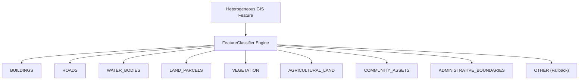

# Phase 2 — Feature Classification & Spatial Validation Report

**Project**: Village Asset Mapping System (Living Digital Village)  
**Pipeline Phase**: Phase 2 — Preprocessing & Standardization  
**Components**: 
1. Standardized Geographic Feature Classification System (`FeatureClassifier`)
2. Spatial Validation & Boundary Alignment Engine (`SpatialValidator`)  
**Target Village**: Gudwara (`491275`), Kareli Tehsil, Narsinghpur District, Madhya Pradesh  
**Acquisition ID**: `acq_1fa4312f8f87`  
**Date**: November 2026  
**Status**: Verified & Tested (40/40 Tests Passing)  

---

## 1. Executive Overview

This report documents the architectural design, algorithmic implementation, and execution of:
1. **The Standardized Geographic Feature Classification System**: Standardizing heterogeneous source datasets (Survey of India SVAMITVA, Gram Manchitra, OSM) into a canonical 9-category internal schema with complete lineage preservation and zero AI hallucination.
2. **The Spatial Validation & Boundary Alignment System**: Validating topological consistency, measuring metric distances in projected CRS (`EPSG:32644` UTM Zone 44N), non-destructive clipping, and evaluating village spatial boundaries.

All operations strictly preserve the foundational rules:
- **Zero raw data modifications**: `data/raw/` remains permanently read-only.
- **Zero silent deletions**: Crossing, unclassified, and outside features are preserved with audit flags.
- **Zero unfounded assumptions**: Institutional categories (schools, hospitals) are assigned *only* when explicit source attributes verify them.

---

## 2. Standardized Feature Schema & Classification Model

### 2.1. Canonical Primary Categories

Every geographical entity is categorized into one of 9 canonical primary categories:



### 2.2. Standardized Feature Model (`StandardizedFeature`)

Each feature conformant with GeoJSON Feature specifications is structured as follows:

```json
{
  "type": "Feature",
  "id": "feat_bc48810e-0d8",
  "geometry": {
    "type": "Polygon",
    "coordinates": [...]
  },
  "properties": {
    "feature_id": "feat_bc48810e-0d8",
    "source_id": "{75297A5C-4DE2-47E8-A0B1-55A54F4F0E46}",
    "source_name": "grammanchitra",
    "source_layer": "grammanchitra_layer_1_20261107_095851",
    "category": "BUILDINGS",
    "subcategory": "abadi_building",
    "village_name": "GUDWARA",
    "lgd_code": "491275",
    "st_area(shape)": 152.37,
    "st_length(shape)": 60.33,
    "raw_attributes": {
      "objectid": 1,
      "uniq_id": "{75297A5C-4DE2-47E8-A0B1-55A54F4F0E46}",
      "built_up_area_type": 19,
      "state_code": "23",
      "district_code": "34"
    },
    "_metadata": {
      "original_crs": "EPSG:4326",
      "processing_status": "classified",
      "classification_method": "rule:exact",
      "classification_confidence": 1.0,
      "raw_properties_count": 21,
      "processing_notes": [
        "Classified as BUILDINGS:abadi_building",
        "Rule match: exact (field: built_up_area_type)"
      ]
    }
  }
}
```

### 2.3. Classification Rule Hierarchy

The `FeatureClassifier` evaluates features in a deterministic order:

1. **Institutional Community Asset Keyword Matching**:
   Inspects `name`, `remarks`, `adl_info`, `area_desc`, and `amenity` against certified institutional dictionaries (e.g. *school, vidyalaya, hospital, swasthya kendra, mandir, panchayat*).
   > [!IMPORTANT]
   > Buildings with generic tags (e.g. `built_up_area_type == 19` or `building == "yes"`) are categorized as `BUILDINGS::abadi_building` or `BUILDINGS::generic`. They are **never** classified as schools, hospitals, or temples without explicit attribute proof.
2. **Specific Attribute Matching**:
   - `road_type == 9` $\rightarrow$ `ROADS::village_road`
   - `pavement == "PAVED"` $\rightarrow$ `ROADS::paved_road`
   - `pavement == "UNPAVED"` $\rightarrow$ `ROADS::unpaved_road`
   - `built_up_area_type == 19` $\rightarrow$ `BUILDINGS::abadi_building`
   - `parcel_type == "Property Parcel"` $\rightarrow$ `LAND_PARCELS::property_parcel`
   - `parcel_type == "Agricultural Parcel"` $\rightarrow$ `AGRICULTURAL_LAND::cropland`
   - OSM `highway` tags $\rightarrow$ `ROADS` (subcategories: `highway`, `village_road`, `path_track`)
   - OSM `waterway` / `natural=water` $\rightarrow$ `WATER_BODIES`
   - OSM `natural` (wood, trees, scrub) $\rightarrow$ `VEGETATION`
3. **Source Layer-Level Fallback**:
   When individual attributes are unpopulated, maps the known source layer:
   - `Road` $\rightarrow$ `ROADS::generic`
   - `Built_Up_Area` $\rightarrow$ `BUILDINGS::generic`
   - `Parcel_Area` $\rightarrow$ `LAND_PARCELS::generic`
4. **Fallback to OTHER**:
   Any feature matching no rule is tagged as `PrimaryCategory.OTHER` with subcategory `unclassified` (confidence: `0.2`) and logged in the unclassified feature report.

---

## 3. Spatial Validation & Boundary Analysis

### 3.1. Village Boundary Definition

In government cadastral datasets, standalone boundary shapefiles for individual Abadi settlements are frequently omitted from MapServer endpoints.
- **Boundary Policy**: We strictly prohibit substituting a Gram Panchayat (GP) boundary for a revenue village boundary without explicit documentation, because a Gram Panchayat typically encompasses 2 to 5 revenue villages and outlying hamlets.
- **Derived Cadastral Boundary**:
  - Derived from the cadastral parcel union (`unary_union`) and built-up extents with a 15-meter buffer in metric CRS (`EPSG:32644`).
  - Explicitly tagged in metadata: `boundary_type = DERIVED_CADASTRAL_HULL`, `is_verified = False`.
  - Derived Area for Gudwara: **$90,142.22\text{ m}^2$ ($\approx 9.01\text{ hectares}$)**.

### 3.2. Metric Spatial Operations (UTM Zone 44N — `EPSG:32644`)

Metric calculations are performed in projected CRS:
- **`within(geom, boundary)`**: Evaluates complete containment ($\text{dist} = 0.0\text{m}$).
- **`intersects(geom, boundary)`**: Detects boundary-straddling features.
- **`distance(geom, boundary)`**: Computes Euclidean distance in meters from boundary perimeter.
- **Outlier Threshold**: Features situated $> 500\text{m}$ beyond the boundary are flagged as suspicious outliers.

### 3.3. Non-Destructive Boundary Clipping

When clipping is requested:
- Fully contained features remain untouched (`clipping_status = NOT_CLIPPED`).
- Crossing features are clipped via `geom.intersection(boundary)` (`clipping_status = CLIPPED_CROSSING`), with the original geometry preserved in `_original_geom_wkt`.
- Outside features are **never discarded**; preserved with `clipping_status = OUTSIDE_UNCLIPPED` and `_spatial_relation = OUTSIDE`.

---

## 4. Execution Results: Gudwara Village (`acq_1fa4312f8f87`)

Executed via:
```bash
python backend/scripts/run_classification_and_spatial_validation.py --acquisition-id acq_1fa4312f8f87
```

### 4.1. Feature Classification Breakdown

| Source Layer | Total Records | Primary Category | Subcategories | Unclassified |
| :--- | :---: | :--- | :--- | :---: |
| **Layer 0 (Roads)** | 106 | `ROADS` (106) | `ROADS::paved_road`: 53<br>`ROADS::village_road`: 53 | 0 |
| **Layer 1 (Built_Up_Area)** | 424 | `BUILDINGS` (424) | `BUILDINGS::abadi_building`: 424 | 0 |
| **Layer 2 (Parcel_Area)** | 242 | `LAND_PARCELS` (242) | `LAND_PARCELS::property_parcel`: 242 | 0 |
| **Consolidated** | **772** | — | — | **0 ($0\%$)** |

### 4.2. Spatial Quality Audit

| Spatial Relationship | Feature Count | Percentage |
| :--- | :---: | :---: |
| **Fully Inside Boundary** | **772** | **100.0%** |
| **Partially Intersecting (Crossing)** | 0 | 0.0% |
| **Outside Boundary** | 0 | 0.0% |
| **Suspicious Outliers ($> 500\text{m}$)** | 0 | 0.0% |
| **Potential Alignment Issues** | 0 | Coherent |

Category Spatial Breakdown:
- `ROADS`: 106 Inside, 0 Crossing, 0 Outside
- `BUILDINGS`: 424 Inside, 0 Crossing, 0 Outside
- `LAND_PARCELS`: 242 Inside, 0 Crossing, 0 Outside

---

## 5. Artifacts and Directory Layout

Generated standardized files are saved in `data/processed/standardized/acq_1fa4312f8f87/`:

```
data/processed/standardized/acq_1fa4312f8f87/
├── classification_summary.json                                      # Consolidated classification stats
├── grammanchitra_layer_0_20261107_095850.standardized.geojson        # Standardized roads (106 records)
├── grammanchitra_layer_0_20261107_095850.classification_report.json  # Road classification audit
├── grammanchitra_layer_1_20261107_095851.standardized.geojson        # Standardized buildings (424 records)
├── grammanchitra_layer_1_20261107_095851.classification_report.json  # Building classification audit
├── grammanchitra_layer_2_20261107_095852.standardized.geojson        # Standardized parcels (242 records)
├── grammanchitra_layer_2_20261107_095852.classification_report.json  # Parcel classification audit
├── gudwara_derived_boundary.geojson                                 # Derived cadastral boundary polygon
├── gudwara_village_audited.geojson                                  # 772 audited features with spatial provenance
└── spatial_validation_report.json                                   # Complete spatial quality audit report
```

---

## 6. Verification and Automated Testing

Automated testing across the backend test suite:
- `backend/tests/test_feature_classifier.py`: 7 tests passing
  - `test_classify_grammanchitra_road`
  - `test_classify_grammanchitra_building_general`
  - `test_classify_institutional_community_asset_by_name`
  - `test_classify_healthcare_facility_keyword`
  - `test_classify_osm_tags`
  - `test_classify_missing_and_unknown_attributes`
  - `test_classify_geodataframe_and_report`
- `backend/tests/test_spatial_validator.py`: 3 tests passing
  - `test_derive_boundary_from_features`
  - `test_spatial_relationships_validation`
  - `test_non_destructive_clipping`

**Overall Test Suite Result**: **40 passed, 0 failed** in `pytest backend/tests -v`.

---

## 7. Next Steps in Phase 2 Pipeline

1. **Step 2.3 — Feature Deduplication & Attribute Reconciliation**:
   - Merge the twin pairs ($386$ duplicate record pairs) identified in Step 2.1 by merging ownership metadata into spatial geometry records.
2. **Step 2.4 — Coordinate Centering & Local Coordinate System Generation**:
   - Transform coordinates from WGS84 to local metric origin $(X-X_0, Y-Y_0, Z)$, preparing exact centimeter-precision mesh offsets for Three.js.
