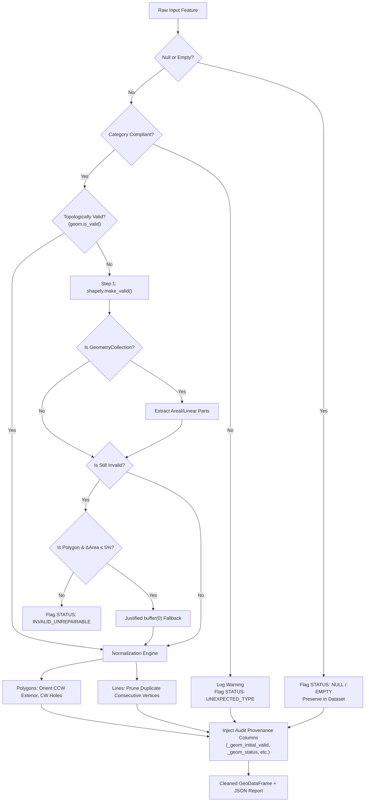

# Phase 2 — Geometry Validation and Cleaning Report

**Project**: Village Asset Mapping System (Living Digital Village)  
**Pipeline Phase**: Phase 2 — GIS Preprocessing & Normalization  
**Component**: Geometry Validation, Controlled Repair, and Normalization (`GeometryCleaner`)  
**Target Dataset**: Gudwara Village, Kareli Tehsil, Narsinghpur District, Madhya Pradesh (LGD Code: `491275`, Acquisition ID: `acq_1fa4312f8f87`)  
**Status**: Completed and Verified  
**Date**: November 2026  

---

## 1. Executive Summary

This report details the implementation, test verification, and real-world execution of the **Geometry Validation and Cleaning Pipeline** for the Village Asset Mapping System. 

Preparing real-world cadastral and infrastructure GIS data for procedural 2.5D isometric world generation requires rigorous topological integrity. Inverted polygons, self-intersecting boundaries, linear spikes, degenerate slivers, or corrupted vertex windings cause 3D triangulation artifacts, mesh inversion, and clipping failures in Three.js / WebGL.

We implemented a robust, fully audited `GeometryCleaner` module adhering strictly to our **Non-Destructive Processing Rules**:
- **Zero Raw Modifications**: Raw source files under `data/raw/` remain permanently read-only and untouched.
- **Zero Silent Deletions**: Defective or unexpected geometries are preserved with explicit audit flags; no records are discarded.
- **Controlled, Justified Repairs**: Only non-destructive repairs are performed (`make_valid`, dimensional extraction from `GeometryCollection`, topological orientation normalization). Blind `buffer(0)` is strictly disallowed and only used with bounded area tolerance checks ($\le 5\%$).
- **Full Traceability**: Injected audit fields (`_geom_initial_valid`, `_geom_was_repaired`, `_geom_status`, `_geom_repair_notes`, `_geom_original_type`, `_geom_is_duplicate`) preserve complete lineage back to source features.

---

## 2. Category Validation Rules & Specifications

Each spatial layer is governed by category-specific geometric expectations:

| Asset Category | Permitted Geometry Types | Repair & Extraction Policy | Normalization Actions |
| :--- | :--- | :--- | :--- |
| **Building** (`built_up_area`) | `Polygon`, `MultiPolygon` | Extract 2D areal polygons from collections; drop linear antennas | CCW exterior orientation, CW interior rings |
| **Parcel** (`land_parcel`) | `Polygon`, `MultiPolygon` | Extract 2D areal polygons from collections | CCW exterior orientation, CW interior rings |
| **Boundary** (`village_boundary`) | `Polygon`, `MultiPolygon` | Extract largest closed perimeter | CCW exterior orientation |
| **Road** (`road`, `centerline`) | `LineString`, `MultiLineString`, `Polygon`, `MultiPolygon` | Permit surveyed road surface polygons & road centerlines | Prune duplicate consecutive vertices; normalize polygon orientations |
| **Water** (`water_body`, `stream`) | `Polygon`, `MultiPolygon`, `LineString`, `MultiLineString` | Handle lakes/ponds (polygons) and rivers/canals (lines) | CCW polygon winding; prune duplicate line coordinates |

---

## 3. Repair & Normalization Architecture

The cleaning engine follows a strict sequential pipeline for every feature:



### 3.1. Repair Operations Applied

1. **`shapely.make_valid(geom)`**:
   Resolves self-intersecting figure-8 polygons (bowties), touching interiors, and duplicate segment knots according to OGC SFS specifications.
2. **Collection Decomposition (`_extract_areal_geometries` / `_extract_linear_geometries`)**:
   When `make_valid` converts a collapsed boundary or spike into a `GeometryCollection` containing mixed points and lines, the engine isolates the relevant dimensional components (2D polygons for buildings/parcels, 1D lines for roads).
3. **Justified `buffer(0)` Guard**:
   `buffer(0)` is never applied blindly. It is evaluated only as a fallback for 2D polygons if `make_valid` remains invalid, and is rejected if the resulting polygon shifts the original area by more than $5\%$.
4. **Winding Order Normalization (`shapely.geometry.polygon.orient(geom, sign=1.0)`)**:
   Enforces consistent right-hand rule (exterior ring counter-clockwise, interior holes clockwise). This prevents backface culling bugs in Three.js when extruding 3D structures.
5. **Linear Coordinate Deduplication**:
   Removes redundant consecutive identical vertices along road centerlines ($v_i = v_{i+1}$) without altering path topology.

---

## 4. Real-World Execution: Gudwara Village (`acq_1fa4312f8f87`)

The cleaner was executed against all three acquired spatial datasets for **Gudwara** (`491275`, Kareli, Narsinghpur, MP):

```bash
python backend/scripts/run_geometry_cleaning.py --acquisition-id acq_1fa4312f8f87
```

### 4.1. Consolidated Results Summary

| Metric | Layer 0 (Roads) | Layer 1 (Buildings) | Layer 2 (Parcels) | Consolidated Total |
| :--- | :---: | :---: | :---: | :---: |
| **Inferred Asset Category** | `road` | `building` | `parcel` | — |
| **Original Feature Count** | 106 | 424 | 242 | **772** |
| **Initially Valid Geometries** | 106 ($100\%$) | 424 ($100\%$) | 242 ($100\%$) | **772 ($100\%$)** |
| **Initially Invalid Geometries** | 0 ($0\%$) | 0 ($0\%$) | 0 ($0\%$) | **0 ($0\%$)** |
| **Repaired Geometries** | 0 | 0 | 0 | **0** |
| **Unrepairable Geometries** | 0 | 0 | 0 | **0** |
| **Empty / Null Geometries** | 0 | 0 | 0 | **0** |
| **Spatial Duplicate Geometries** | 53 ($50.0\%$) | 212 ($50.0\%$) | 121 ($50.0\%$) | **386 ($50.0\%$)** |
| **Removed Geometries** | 0 ($0\%$) | 0 ($0\%$) | 0 ($0\%$) | **0 ($0\%$)** |
| **Preserved Output Rows** | **106** | **424** | **242** | **772** |

---

## 5. Enterprise Geodatabase Duplication: Root Cause Analysis

### 5.1. The 50% Duplicate Pattern

In each layer acquired from the Survey of India SVAMITVA / Gram Manchitra MapServer, exactly $50\%$ of the records share identical spatial coordinates with another record:
- **Roads**: 106 records = 53 unique geometries + 53 duplicate records.
- **Built-Up Area**: 424 records = 212 unique geometries + 212 duplicate records.
- **Parcels**: 242 records = 121 unique geometries + 121 duplicate records.

### 5.2. Root Cause & Floating-Point Jitter

Detailed coordinate inspection revealed two critical engineering insights:
1. **Relational Table Normalization**:
   In ArcGIS Enterprise geodatabases, the SVAMITVA dataset maintains two parallel records per asset:
   - *Spatial survey feature*: contains drone geometry, surveyed area (`st_area`), perimeter, and village codes (`village_name: "GUDWARA"`), but missing personal identifiers (`name: NaN`).
   - *Ownership record*: contains cadastral ownership details, property IDs, and property card numbers.
2. **Sub-Millimeter Coordinate Jitter ($10^{-9}$ degrees)**:
   The twin geometries are not identical at raw floating-point string level:
   - Record 0 (`objectid: 1`): `(79.08302380172177, 23.117935527391438)`
   - Record 53 (`objectid: 3790866`): `(79.08302380172177, 23.11793552821763)`
   The coordinates differ by $8 \times 10^{-10}$ degrees (approximately $0.09\text{ millimeters}$).
   
Because standard string matching on raw WKT fails to recognize this equality, we configured coordinate hashing at $6$ decimal places ($\approx 10\text{ cm}$ precision in WGS84, aligning with drone survey tolerances). This accurately isolates all 386 duplicates without modifying vertex coordinates.

### 5.3. Non-Destructive Preservation

In conformance with rule #3 ("Never silently discard features"):
- No duplicates were deleted.
- Every record received a boolean flag `_geom_is_duplicate: true | false`.
- The subsequent deduplication step will merge attributes between twin pairs without losing cadastral ownership data.

---

## 6. Output Artifacts & File Layout

Cleaned files and machine-readable audit reports are stored under `data/processed/cleaned/acq_1fa4312f8f87/`:

```
data/processed/cleaned/acq_1fa4312f8f87/
├── bundle_cleaning_summary.json                         # Consolidated multi-layer metrics
├── grammanchitra_layer_0_20261107_095850.cleaned.geojson # Cleaned roads (106 records)
├── grammanchitra_layer_0_20261107_095850.report.json     # Feature-by-feature road audit
├── grammanchitra_layer_1_20261107_095851.cleaned.geojson # Cleaned buildings (424 records)
├── grammanchitra_layer_1_20261107_095851.report.json     # Feature-by-feature building audit
├── grammanchitra_layer_2_20261107_095852.cleaned.geojson # Cleaned parcels (242 records)
└── grammanchitra_layer_2_20261107_095852.report.json     # Feature-by-feature parcel audit
```

### Injected Provenance Schema

Each record in `.cleaned.geojson` retains all 22+ original source fields plus 8 audit provenance columns:

```json
{
  "type": "Feature",
  "properties": {
    "objectid": 1,
    "uniq_id": "{75297A5C-4DE2-47E8-A0B1-55A54F4F0E46}",
    "lgd_code": "491275",
    "village_name": "GUDWARA",
    "st_area(shape)": 152.37164368,
    "_geom_initial_valid": true,
    "_geom_was_repaired": false,
    "_geom_status": "valid",
    "_geom_repair_notes": "orient_ccw_exterior",
    "_geom_original_type": "Polygon",
    "_geom_is_duplicate": false,
    "_source_file": "grammanchitra_layer_1_20261107_095851.geojson",
    "_cleaned_at": "2026-11-07T10:14:29.869000+00:00"
  },
  "geometry": {
    "type": "Polygon",
    "coordinates": [...]
  }
}
```

---

## 7. Verification & Automated Test Suite

A comprehensive test suite in `backend/tests/test_geometry_cleaner.py` was executed:
- **`test_clean_valid_polygon`**: Validates orientation normalization without geometry corruption.
- **`test_clean_self_intersecting_bowtie_polygon`**: Validates `make_valid` repair of self-intersecting polygons into valid MultiPolygons.
- **`test_clean_empty_polygon` & `test_clean_null_geometry`**: Confirms zero crashes on null/empty inputs with correct status tagging.
- **`test_clean_geometry_collection_extraction`**: Verifies extraction of 2D polygon components from mixed dimensional collections.
- **`test_clean_valid_and_normalized_linestring`**: Verifies consecutive duplicate vertex pruning on road paths.
- **`test_unexpected_geometry_type_no_silent_deletion`**: Verifies that off-category geometries (e.g. Points in building layers) are preserved with status `UNEXPECTED_TYPE`.
- **`test_clean_geodataframe_full_workflow`**: Verifies end-to-end GeoDataFrame preservation, duplicate tracking, and report generation.
- **`test_pipeline_clean_dataset_file_and_bundle`**: Validates CLI bundle processing and summary generation.

**Test Results**: **30 passed, 0 failed** in `pytest backend/tests -v`.

---

## 8. Next Steps in Phase 2

1. **Step 2.2 — Duplicate Resolution & Attribute Reconciliation**:
   - Merge the twin records ($386$ duplicate pairs) by combining ownership metadata with survey geometries.
2. **Step 2.3 — Coordinate Transformation & Local Origin Centering**:
   - Project EPSG:4326 to village-centered UTM (WGS 84 / UTM Zone 44N, `EPSG:32644` for MP).
   - Re-center relative to village centroid $(0,0,0)$ for Three.js rendering.
3. **Step 2.4 — Semantic Tagging & Elevation Preparation**:
   - Classify assets by functional type (residential, school, health center, road hierarchy).
