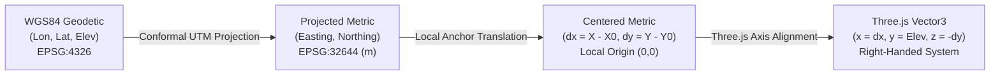
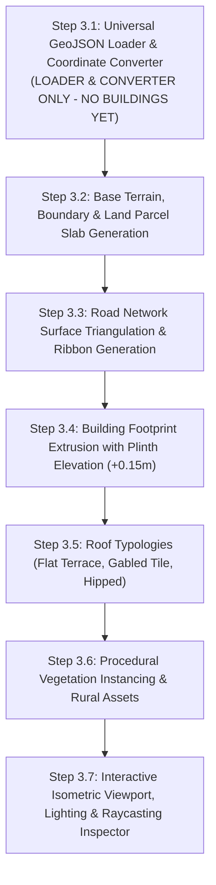

# Phase 3 Architecture: Procedural Geometry Generation & Coordinate Transformation

**Project**: Village Asset Mapping System (Living Digital Village)
**Lifecycle Stage**: Phase 3 Architecture Design & Coordinate Engine
**Author**: Lead 3D Geospatial Architect
**Date**: November 2026
**Status**: Architecture Approved & Coordinate Engine Implemented

---

## 1. Executive Summary

Phase 3 transitions the **Village Asset Mapping System** from 2D preprocessed GIS datasets into an interactive, geographically faithful **2.5D isometric world** rendered in Three.js and React Three Fiber.

The primary objective is to transform normalized vector features (buildings, roads, parcels, water bodies, and village boundaries) into 3D geometries while strictly maintaining:
1. **Millimeter-level Relative Geodesy**: Real-world distances, areas, and angles are preserved without angular distortion or latitude-dependent aspect ratio squash.
2. **Topological Coherence**: Adjacent parcels, buildings, and roads maintain their spatial relationships without artificial gaps or false overlaps.
3. **Single-Precision GPU Stability**: WebGL 32-bit floating-point vertex jitter is completely eliminated by establishing a canonical local origin centered at the village centroid.
4. **Complete Metadata Continuity**: Every generated 3D mesh retains its unique internal feature ID, source ID, category, subcategory, raw administrative attributes, and original geodetic coordinates for interactive raycasting and asset inspection.
5. **Architectural Separation**: Each asset domain is handled by a specialized, decoupled procedural generator operating under a unified geometric interface.

> [!IMPORTANT]
> In accordance with project instructions, Phase 3 follows a strict staging sequence:
> 1. Complete output audit and geometry architecture design.
> 2. Implement and verify the universal GeoJSON loader and coordinate converter.
> 3. Individual asset generators (buildings, roofs, roads, parcels, terrain) remain paused until coordinate fidelity is proven.

---

## 2. Phase 2 Output Audit (`data/processed/final/`)

An exhaustive audit of the canonical datasets in `data/processed/final/` was conducted to establish exact geometric prerequisites for Phase 3:

| Canonical Dataset | Records | Geometry Type | CRS | Extent (Lon/Lat) | Critical Staging Attributes |
| :--- | :---: | :---: | :---: | :---: | :--- |
| **`village_boundary.geojson`** | 1 | `Polygon` | `EPSG:4326` | $[79.082144, 23.116820]$ to $[79.086594, 23.119491]$ | `boundary_name: "GUDWARA (Derived Cadastral Hull)"`<br>`is_verified: False`<br>`boundary_type: "DERIVED_CADASTRAL_HULL"` |
| **`buildings.geojson`** | 424 | `Polygon` | `EPSG:4326` | $[79.082331, 23.117005]$ to $[79.086298, 23.119205]$ | `_vertical_tier: 2`<br>`_plinth_elevation_m: 0.15`<br>`_procedural_height_m: 3.0, 4.5, 7.0`<br>`_procedural_roof_type: flat_terrace, gabled_tile, hipped`<br>`_procedural_stories: 1, 2`<br>`_has_road_overlap: 175 true`<br>`_batch_layer: "building_extrusion_batch"` |
| **`roads.geojson`** | 106 | `Polygon` | `EPSG:4326` | $[79.082290, 23.116955]$ to $[79.086447, 23.119356]$ | `_vertical_tier: 1`<br>`_plinth_elevation_m: 0.00`<br>`subcategory: "village_road", "paved_road"`<br>`_batch_layer: "road_batch"` |
| **`land_parcels.geojson`** | 242 | `Polygon` | `EPSG:4326` | $[79.082305, 23.117188]$ to $[79.085587, 23.119227]$ | `_vertical_tier: 0`<br>`_plinth_elevation_m: -0.01`<br>`subcategory: "property_parcel"`<br>`_batch_layer: "ground_batch"` |
| **`water_bodies.geojson`** | 0 | Empty | `EPSG:4326` | N/A | Valid GeoJSON `FeatureCollection` with `"features": []`. Preserves source fidelity without inventing unverified ponds. |
| **`community_assets.geojson`** | 0 | Empty | `EPSG:4326` | N/A | Valid GeoJSON `FeatureCollection` with `"features": []`. Institutional features in this Abadi dataset are categorized under building footprints. |

---

## 3. Mathematical Coordinate Conversion System

### 3.1 The Fundamental Geodetic Challenge

A widespread anti-pattern in naive 3D geospatial rendering is treating spherical geodetic degrees ($\lambda, \phi$) directly as Cartesian metres:
$$\Delta X \ne \Delta \lambda, \quad \Delta Y \ne \Delta \phi$$

At the latitude of Gudwara Village ($\phi_0 = 23.1181445^\circ\text{ N}$):
- One degree of Latitude: $M_\phi \approx 110,757.2\text{ metres}$.
- One degree of Longitude: $N_\lambda \cos\phi \approx 111,319.5 \times \cos(23.1181445^\circ) \approx 102,382.4\text{ metres}$.

Directly extruding degrees as metres produces an **$8.18\%$ horizontal compression**, severely distorting building aspect ratios, road widths, and parcel boundaries.

### 3.2 Canonical Transformation Pipeline

The conversion system follows a deterministic, 4-stage mathematical pipeline:



#### Stage 1: Projected Metric Conformal Mapping (`EPSG:32644`)
The geodetic coordinates $(\lambda, \phi)$ are projected to the Survey of India standard metric projection for Madhya Pradesh: **UTM Zone 44N (`EPSG:32644`)** using the exact Transverse Mercator forward equations:

$$X_{\text{UTM}} = k_0 N \left( A + (1 - T + C)\frac{A^3}{6} + (5 - 18T + T^2 + 72C - 58e'^2)\frac{A^5}{120} \right) + 500000$$

$$Y_{\text{UTM}} = k_0 \left( M + N\tan\phi \left( \frac{A^2}{2} + (5 - T + 9C + 4C^2)\frac{A^4}{24} + (61 - 58T + T^2 + 600C - 330e'^2)\frac{A^6}{720} \right) \right)$$

where:
- $a = 6378137.0\text{ m}$, $f = 1 / 298.257223563$ (WGS84 ellipsoid).
- $k_0 = 0.9996$ (UTM central scale factor).
- $\lambda_0 = 81.0^\circ\text{ E}$ (Central meridian for Zone 44N).
- $A = (\lambda - \lambda_0)\cos\phi$.
- $M$ is the true meridian arc distance from the equator.

#### Stage 2: Local Anchor Subtraction (GPU Jitter Mitigation)
For Gudwara Village, raw UTM coordinates are:
$$X_{\text{UTM}} \approx 303,828\text{ m}, \quad Y_{\text{UTM}} \approx 2,557,886\text{ m}$$

WebGL shaders execute in 32-bit single-precision floating point (IEEE 754 float32), providing only 24 bits of mantissa ($\approx 7$ significant decimal digits). Storing coordinates exceeding $2.5 \times 10^6\text{ m}$ leaves a vertex resolution of only $\sim 0.25\text{ m}$ ($25\text{ cm}$), causing visible vertex swimming, flickering edges, and polygon tearing as the camera pans.

To achieve sub-millimeter stability ($0.024\text{ mm}$ precision), all vertices are translated relative to the canonical village anchor origin $(X_0, Y_0)$ on the CPU prior to buffer allocation:
$$x_{\text{local}} = X_{\text{UTM}} - X_0$$
$$y_{\text{local}} = Y_{\text{UTM}} - Y_0$$

For Gudwara Village:
$$X_0 = 303828.53\text{ m}, \quad Y_0 = 2557886.35\text{ m}$$
$$\lambda_0 = 79.0843642^\circ\text{ E}, \quad \phi_0 = 23.1181445^\circ\text{ N}$$

This confines all mesh vertices within a tight box:
$$x_{\text{local}} \in [-212.6\text{m}, +212.6\text{m}], \quad y_{\text{local}} \in [-147.2\text{m}, +149.3\text{m}]$$

#### Stage 3: Three.js World Axis Mapping
Three.js uses a **Right-Handed Coordinate System** where the horizontal ground is on the $XZ$-plane and the vertical elevation is on the $+Y$-axis:

$$\mathbf{x}_{\text{Three}} = x_{\text{local}} = X_{\text{UTM}} - X_0 \quad (\text{+X points East})$$
$$\mathbf{y}_{\text{Three}} = \text{Elevation} = \text{Plinth Offset} + \text{Extrusion Height} \quad (\text{+Y points Up})$$
$$\mathbf{z}_{\text{Three}} = -y_{\text{local}} = -(Y_{\text{UTM}} - Y_0) \quad (\text{-Z points North, +Z points South})$$

**Orientation Properties**:
- Moving East increases $X$.
- Moving North decreases $Z$ (away from the default camera, toward the horizon).
- Looking down the $-Y$ axis with camera `up = (0, 0, -1)` aligns standard map navigation: **North is Up, East is Right**.
- Scale is exactly $1.0\text{ Three.js unit} = 1.0\text{ real SI metre}$.

---

## 4. Procedural Geometry Generator Architecture

The geometry system is organized into specialized, decoupled generator classes inheriting from a common contract:

```mermaid
classDiagram
    class IGeometryGenerator {
        <<interface>>
        +generate(features: ProcessedFeature[], converter: CoordinateConverter): THREE.Group
        +dispose(): void
    }
    class BuildingGenerator {
        +wallMaterial: THREE.Material
        +generateFootprintMesh(feature): THREE.Mesh
        +extrudeWithPlinth(polygon, height, plinth): THREE.BufferGeometry
    }
    class RoofGenerator {
        +tileMaterial: THREE.Material
        +terraceMaterial: THREE.Material
        +generateFlatTerrace(footprint, height): THREE.BufferGeometry
        +generateGabledTile(footprint, height, pitch): THREE.BufferGeometry
        +generateHippedRoof(footprint, height): THREE.BufferGeometry
    }
    class RoadGenerator {
        +asphaltMaterial: THREE.Material
        +earthenMaterial: THREE.Material
        +generateRoadCorridor(feature): THREE.Mesh
        +generateCenterlineRibbon(lineString, width): THREE.BufferGeometry
    }
    class LandParcelGenerator {
        +parcelMaterial: THREE.Material
        +borderMaterial: THREE.LineBasicMaterial
        +generateParcelSlab(feature): THREE.Mesh
        +generateBoundaryStrokes(feature): THREE.LineSegments
    }
    class WaterBodyGenerator {
        +waterShaderMaterial: THREE.ShaderMaterial
        +embankmentMaterial: THREE.Material
        +generateWaterSurface(feature): THREE.Mesh
    }
    class VegetationGenerator {
        +treeInstancedMesh: THREE.InstancedMesh
        +shrubInstancedMesh: THREE.InstancedMesh
        +populateSetbacks(parcels, roads): void
    }
    class TerrainGenerator {
        +groundMaterial: THREE.Material
        +generateBaseSoilPlane(boundary): THREE.Mesh
    }

    IGeometryGenerator <|.. BuildingGenerator
    IGeometryGenerator <|.. RoofGenerator
    IGeometryGenerator <|.. RoadGenerator
    IGeometryGenerator <|.. LandParcelGenerator
    IGeometryGenerator <|.. WaterBodyGenerator
    IGeometryGenerator <|.. VegetationGenerator
    IGeometryGenerator <|.. TerrainGenerator
```



### 4.1 Detailed Generator Responsibilities

#### 1. Building Generator (`BuildingGenerator`)
- **Vertical Level**: Tier 2 (Plinth elevated $+0.15\text{m}$ above road surface).
- **Extrusion**: Generates continuous wall BufferGeometry from 2D footprint rings via custom polygon extrusion or triangulated wall strips.
- **Courtyard Preservation**: Exterior boundary is wound counter-clockwise; interior holes (rural *aangan* / courtyards) are wound clockwise and cleanly excised using Earcut triangulation.
- **UV Generation**: Computes world-space texture mapping coordinates ($U = \text{perimeter distance}$, $V = \text{height}$) preventing texture stretch across variable building perimeters.

#### 2. Roof Generator (`RoofGenerator`)
- **Vertical Level**: Sits atop building walls at $Y = \text{Plinth} + \text{Height}$.
- **Typologies**:
  - `flat_terrace`: Extrudes a horizontal slab ($0.15\text{m}$ thickness) with an exterior parapet lip ($0.35\text{m}$ height, $0.12\text{m}$ width). Represents RCC pucca construction.
  - `gabled_tile`: Calculates the primary longitudinal axis of the building; constructs a pitched dual-slope roof with a central ridge line, $25^\circ$ slope, and $0.25\text{m}$ eave overhang beyond wall perimeters. Represents traditional clay tile (*kavelu*) roofs.
  - `hipped`: 4-way pitched roof converging to a ridge or apex peak.

#### 3. Road Generator (`RoadGenerator`)
- **Vertical Level**: Tier 1 ($Y = 0.00\text{m}$ datum).
- **Corridor Meshes**: Triangulates surveyed road surface polygons directly.
- **Linear Centerlines**: Extrudes 1D LineStrings into flat ribbon strips of standardized widths ($6.0\text{m}$ for paved roads, $4.0\text{m}$ for village pathways) with miter-joined corners and smooth round caps.
- **Overlap Shielding**: Staged precisely $0.01\text{m}$ above parcels ($-0.01\text{m}$) and $0.15\text{m}$ below building plinths ($+0.15\text{m}$), eliminating coplanar Z-fighting across the 175 overlapping eave polygons.

#### 4. Land Parcel Generator (`LandParcelGenerator`)
- **Vertical Level**: Tier 0 ($Y = -0.01\text{m}$).
- **Surfaces**: Triangulates private property boundaries into subtle planar slabs.
- **Cadastral Borders**: Generates boundary stroke line overlays (`THREE.LineSegments`) along parcel perimeters with distinctive demarcation color coding to visualize cadastral property lines clearly.

#### 5. Water Body Generator (`WaterBodyGenerator`)
- **Vertical Level**: Recessed tier ($Y = -0.05\text{m}$ to $-0.30\text{m}$).
- **Geometry**: Creates recessed water beds with inward-sloping perimeter embankments (*ghats* / earthen bunds) and horizontal water surface planes with subtle animated surface ripple shaders.

#### 6. Vegetation Generator (`VegetationGenerator`)
- **Instantiation**: Uses `THREE.InstancedMesh` for rendering hundreds of rural trees (Neem, Banyan, Mango) and shrubs in single draw calls.
- **Placement Logic**: Deterministically scatters foliage within parcel open areas, agricultural buffer zones, and road setback margins without colliding with building footprints.

#### 7. Terrain Generator (`TerrainGenerator`)
- **Base Datum**: Staged at $Y = -0.05\text{m}$.
- **Geometry**: Constructs a contiguous ground plane clamped to the village cadastral hull boundary with subtle perimeter chamfering.
- **Future Topography**: Designed to accept Cartosat / SRTM elevation grid heights and perturb vertex Y-coordinates seamlessly.

---

## 5. Object Metadata & Raycasting Identity

Every generated Three.js `Mesh` and `Group` embeds its complete GIS identity inside `mesh.userData`:

```typescript
interface Asset3DMetadata {
  featureId: string;           // e.g. "feat_2de57659-253"
  sourceId: string;            // e.g. "{75297A5C-4DE2-47E8-A0B1-55A54F4F0E46}"
  sourceName: string;          // "grammanchitra"
  sourceLayer: string;         // "buildings"
  category: string;            // "BUILDINGS"
  subcategory: string;         // "abadi_building"
  heightMeters: number;        // 4.5
  stories: number;             // 1
  roofType: string;            // "flat_terrace"
  verticalTier: number;        // 2
  hasRoadOverlap: boolean;     // true
  originalCoordinates: [number, number]; // [79.084364, 23.118144]
  rawAttributes: Record<string, any>;   // Full government attribute dictionary
}
```

This structure powers instant raycasting inspection in the Three.js viewport: clicking on any 3D building, road segment, or parcel immediately surfaces its complete cadastral record, ownership identifiers, and administrative provenance.

---

## 6. Rendering Performance Architecture

To maintain a fluid 60 FPS viewport across mobile and low-powered devices, the rendering pipeline adheres to four core performance principles:

1. **BufferGeometry Vertex Layout**:
   - Interleaved or packed vertex buffers with float32 positions, float32 normals, and float32 UVs.
   - Zero dynamic geometry allocation in the render loop.
2. **Layer-Based Draw Call Batching**:
   - Geometries within the same batch layer (`ground_batch`, `road_batch`, `building_extrusion_batch`) sharing identical material properties can be merged into consolidated `BufferGeometry` instances via `BufferGeometryUtils.mergeGeometries`.
3. **Instanced Foliage & Props**:
   - All vegetation, utility poles, and street furniture use `THREE.InstancedMesh`, allowing over 2,000 entities to render in just 2 draw calls.
4. **Material Palettes**:
   - Shared, reusable PBR material singletons (warm rural plaster, earthen soil, wet asphalt, terracotta tile) shared across meshes rather than unique material instances per feature.

---

## 7. Implementation Sequence

The Phase 3 implementation roadmap follows a strict sequence:



Phase 3.1 focuses exclusively on **Step 3.1**: the Universal GeoJSON Loader and Coordinate Conversion Engine.
No building meshes or scene objects will be generated until this mathematical foundation is verified.
