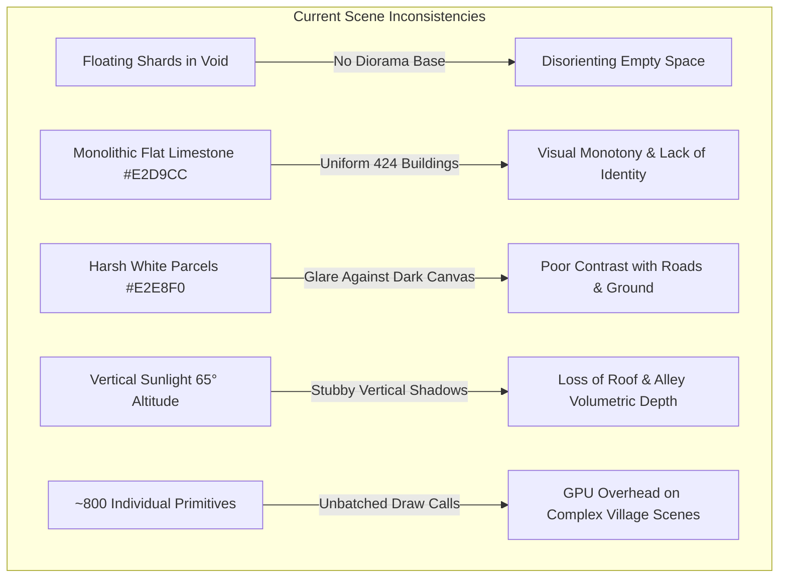
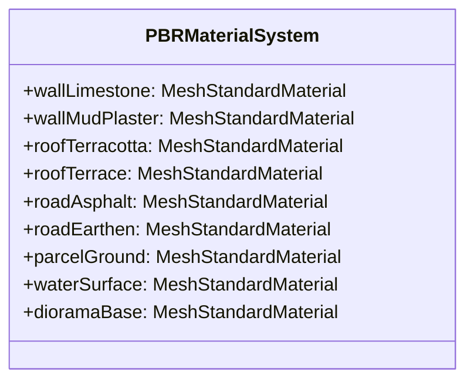
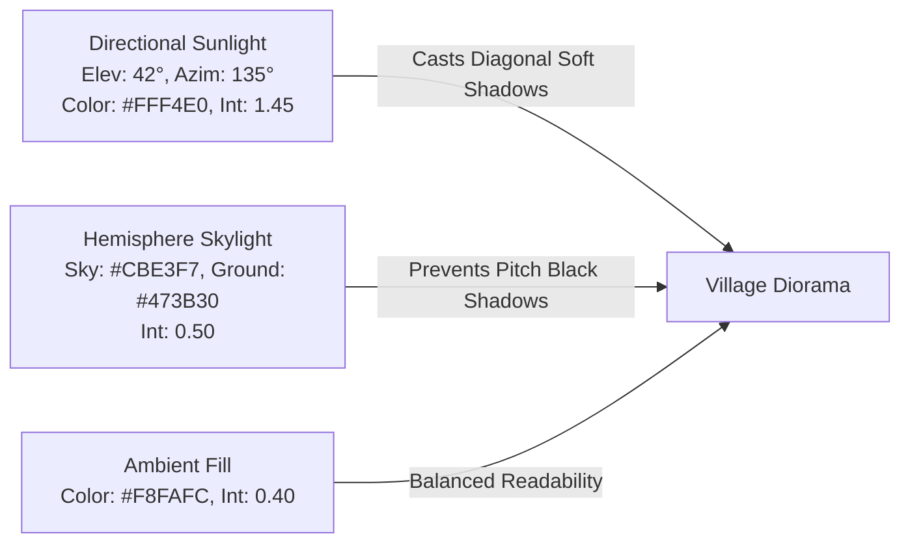
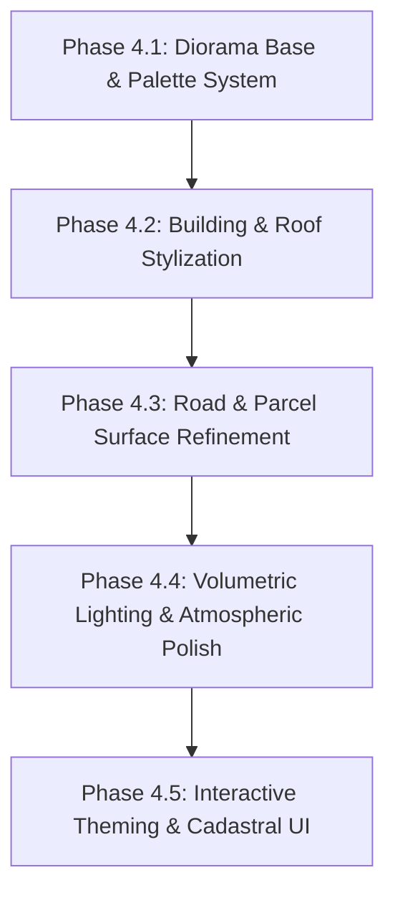

# Phase 4 — Visual Design System & Isometric Art Direction

**Project**: Village Asset Mapping System (Living Digital Village)  
**Document**: `docs/phase_4_visual_design.md`  
**Date**: November 7, 2026  
**Status**: DRAFT PROPOSAL (Pending User Approval)  
**Target Village**: Gudwara, Gadarwara Tehsil, Narsinghpur District, Madhya Pradesh  

---

## 1. Executive Summary & Core Art Direction

### 1.1 The Design Philosophy: "Living Rural Diorama" (जीवंत ग्रामीण प्रतिरूप)
The objective of Phase 4 is to elevate our verified 3D GIS geometries into a **visually captivating, handcrafted isometric game world**—reminiscent of tactile architectural scale models and celebrated isometric games such as *Townscaper*, *Monument Valley*, and *SimCity*, while maintaining strict **sub-millimeter cadastral fidelity**.

> [!IMPORTANT]
> **Core Design Principle**:
> This is **not a conventional CAD/GIS map** with 3D extrusions tacked on, nor is it a fantasy video game with randomly scattered assets.
> Every building, road corridor, and parcel slab originates from verified government GIS surveys (SVAMITVA & Gram Manchitra).
> Our role in Phase 4 is to apply **artistic discipline, harmonic color theory, and volumetric lighting** so that actual Indian rural geography feels alive, readable, warm, and inviting.

```
       +-------------------------------------------------------------+
       |                  LIVING RURAL DIORAMA                       |
       +-------------------------------------------------------------+
       |  AUTHENTIC CADASTRAL DATA   +   STYLIZED ISOMETRIC ARTISTRY |
       |  - 424 Surveyed Buildings   |   - Warm Central Indian Palettes|
       |  - 106 Road Corridors       |   - Tactile Diorama Pedestal  |
       |  - 242 Property Parcels     |   - Soft 42° Diagonal Shadows |
       |  - Real Boundary Geometry   |   - Controlled Volumetric Scale|
       +-------------------------------------------------------------+
```

### 1.2 Key Aesthetic Pillars
1. **Clean Geometric Clarity**: Stylized matte surfaces, subtle bevels, and crisp silhouette separation. No noisy wireframes or uncurated polygon triangulation seams.
2. **Warm Central Indian Color Palette**: Organic lime-washes (*chuna*), sun-baked terracotta tile (*kavelu*), natural earth plasters (*geru/mitti*), and weathered stone plinths reflecting the Narmada Valley rural landscape of Madhya Pradesh.
3. **Volumetric Readability**: A controlled $1.2\times$ vertical height exaggeration to eliminate the flat, squashed appearance of single-storey structures under orthographic projection.
4. **Grounded Tactile Presentation**: Enclosing the village within a monolithic, stratified sandstone diorama pedestal extruded from the official village cadastral boundary, floating over an atmospheric warm-slate canvas.
5. **Zero Hallucination / True Data Continuity**: No generic asset spam. Trees, water, and infrastructure appear exclusively when supported by surveyed geographic features.

---

## 2. Technical Audit of Existing Scene (Phase 3 Status)

An exhaustive inspection of the existing scene graph, generators, materials, and camera controls reveals several visual inconsistencies and architectural friction points:



### 2.1 Visual Inconsistencies Identified
1. **Disembodied Floating Polygons**: The village features float over an empty dark slate background (`#0f172a`) with a CAD-style wireframe grid helper (`#334155`). Without a unified physical ground pedestal, the village feels like an unfinished engineering debug view rather than an inhabited settlement.
2. **Monochrome Building Walls**: All 424 buildings share a single, identical wall material (`#e2d9cc`). In an authentic Indian village, structures exhibit diverse vernacular treatments: whitewashed lime, earthen mud-straw plaster, exposed red brick masonry, and painted plinths.
3. **Contrast Glare on Cadastral Parcels**: Land parcels are rendered in flat pale grey (`#e2e8f0`), producing severe glare against the dark viewport and obscuring the distinction between property courtyards, roads, and open ground.
4. **Orthographic Elevation Flattening**: Because orthographic cameras have zero perspective foreshortening, low single-storey houses ($3.0\text{m} - 3.5\text{m}$ high) appear paper-thin when viewed from an isometric pitch ($\approx 35.3^\circ$), losing their spatial presence.
5. **High-Altitude Harsh Sunlight**: The directional key light sits high at $[180, 280, 140]$ (solar elevation $>60^\circ$). This casts tiny, near-vertical shadows directly underneath eaves, failing to define the intricate alleyways (*gali*) and volumetric roof angles.
6. **Subtle Road-to-Parcel Elevation Separation**: Roads sit at $Y = 0.00\text{m}$ and parcels at $Y = -0.01\text{m}$. A $1\text{cm}$ step is physically accurate but visually indistinguishable from isometric camera distances, causing roads to look like drawn lines rather than distinct physical surfaces.

---

## 3. Camera Perspective & Axonometric Proportions

### 3.1 Mathematical Isometric Axonometry
To produce the classic video game isometric perspective where parallel lines never converge and measurements along all major axes are uniformly scaled, we utilize an **Orthographic Camera** positioned at equal Cartesian coordinates:

$$\mathbf{P}_{\text{cam}} = [D, D, D], \quad \text{looking at } [0, 0, 0]$$

```
                   Y (Up)
                   |
                   |      * Camera [D, D, D]
                   |     /
                   |    /  Pitch = 35.264°
                   |   /
                   |  /  Azimuth = 45.0°
                   | /
                   +------------------ X (East)
                  /
                 /
                /
               Z (South / -Z is North)
```

- **Pitch (Elevation Angle)**:
  $$\theta = \arctan\left(\frac{1}{\sqrt{2}}\right) \approx 35.2643897^\circ \quad (\text{or } 35^\circ 15' 52'')$$
- **Azimuth (Horizontal Rotation)**:
  $$\phi = \arctan(1) = 45.0^\circ$$
- **Axis Foreshortening**:
  Every axis ($X, Y, Z$) is foreshortened by the exact same ratio:
  $$S = \sqrt{\frac{2}{3}} \approx 0.81649658$$
  This guarantees that circles project to clean ellipses with a precise major-to-minor axis ratio of $\sqrt{3} : 1$, eliminating visual skew.

### 3.2 Camera Parameters & Control Constraints
| Parameter | Value | Rationale |
| :--- | :--- | :--- |
| **Camera Type** | `THREE.OrthographicCamera` | Eliminates vanishing-point distortion; preserves true isometric grid. |
| **Default Position** | `[220, 220, 220]` | Canonical $45^\circ$ diagonal viewing vector. |
| **Default Target** | `[0, 0, 0]` | Centered on the canonical village anchor origin $(X_0, Y_0)$. |
| **Default Zoom** | `2.4` | Frames the entire core Abadi settlement (~$400\text{m} \times 300\text{m}$) within standard 1080p viewports. |
| **Zoom Bounds** | `minZoom: 1.2`, `maxZoom: 9.0` | Prevents disorientation from extreme zoom-out while allowing granular parcel inspection. |
| **Polar Angle Clamp** | `minPolar: 15°`, `maxPolar: 75°` | Prevents the camera from flipping underneath the diorama base while permitting dynamic orbit. |
| **Damping Factor** | `0.05` | Cinematic, fluid pan and orbit feel. |

---

## 4. Object Proportions & Vertical Exaggeration

In cartography and isometric game design, maintaining a strict 1:1 vertical ratio under orthographic projection creates unreadable, flattened models because human perception relies on vertical depth cues (shadows and wall exposure) that perspective normally provides.

### 4.1 The $1.2\times$ Vertical Scale Principle
To deliver rich, satisfying architectural volumes without altering the underlying cadastral ground coordinates, we establish a **$1.2\times$ Controlled Vertical Exaggeration**:

$$\mathbf{y}_{\text{visual}} = \text{Plinth} + (\text{Height}_{\text{real}} \times 1.20)$$

| Element | Real-World Scale | Visual Staging in Scene | Perceptual Benefit |
| :--- | :---: | :---: | :--- |
| **Plinth Foundation** | $0.15\text{m}$ | **$0.25\text{m}$** (Slate/Stone) | Distinct foundation stepping separating houses from courtyard ground. |
| **Single-Storey House** | $3.00\text{m}$ | **$3.60\text{m}$** | Walls emerge boldly above surrounding compound walls and roads. |
| **Two-Storey House** | $6.00\text{m}$ | **$7.20\text{m}$** | Clear vertical hierarchy for prominent village landmarks. |
| **Terrace Parapet** | $0.35\text{m}$ | **$0.45\text{m}$** | Parapet rim casts a distinct inner shadow onto flat roof slabs. |
| **Gable Roof Pitch** | $25.0^\circ$ | **$28.0^\circ$** | Accentuates terracotta ridge lines and clay tile patterns. |
| **Road Surface** | $0.00\text{m}$ | **$+0.04\text{m}$** | Gives roads a tangible curb/shoulder thickness above parcels. |
| **Parcel Slab** | $-0.01\text{m}$ | **$0.00\text{m}$** | Crisp ground baseline for the village surface. |
| **Diorama Base** | $-0.05\text{m}$ | **$-6.00\text{m}$** | Deep, substantial stone diorama plinth grounding the village. |

---

## 5. Central Indian Rural Colour Palette & Materials

The colour system is directly inspired by the natural building materials and geology of the **Narmada River basin, Madhya Pradesh**: alluvial clay soils, terracotta roof tiles, lime-washed plaster, basalt stone, and sun-dried straw.

```
+--------------------------------------------------------------------------------+
|                 PALETTE: CENTRAL INDIAN RURAL VERNACULAR                       |
+--------------------------------------------------------------------------------+
|  [#F5EFE6]  Chuna Lime-Wash       (Primary Residential Walls)                  |
|  [#E8DDD0]  Warm Earthen Plaster  (Traditional Mud-Straw Walls)                |
|  [#C25E36]  Terracotta Tile       (Khaprail Roofs & Accents)                   |
|  [#8C381E]  Deep Burnt Clay       (Roof Ridges & Trim)                         |
|  [#B8B0A2]  Weathered Terrace     (Flat Concrete Chhat)                        |
|  [#5A6472]  Slate Basalt          (Building Plinths & Foundation)              |
|  [#3F4854]  Pucca Asphalt         (Paved Village Roads)                        |
|  [#B89F7D]  Kutcha Soil           (Earthen Village Pathways)                   |
|  [#DDD5C1]  Cadastral Parcel      (Courtyards & Threshing Floors)              |
|  [#2B7A78]  Narmada Teal          (Reflective Pond Water)                      |
|  [#3E7B42]  Neem Foliage          (Surveyed Tree Canopy)                       |
|  [#5A4634]  Diorama Sandstone     (Pedestal Base Slab)                         |
+--------------------------------------------------------------------------------+
```

### 5.1 Material Specifications (PBR Roughness / Metalness)



#### 1. Residential & Institutional Building Walls
- **Chuna Lime-Wash (`#F5EFE6`)**:
  - `roughness: 0.88`, `metalness: 0.02`. Soft, matte plaster with warm sunlight absorption.
- **Warm Earthen Plaster (`#E8DDD0`)**:
  - `roughness: 0.92`, `metalness: 0.01`. Natural sun-baked mud finish for traditional dwellings.
- **Subtle Façade Procedural Variation**:
  To avoid visual monotony, walls are assigned one of 3 harmonized tones based on a deterministic hash of `featureId`:
  - Tone A (60%): `#F5EFE6` (Pure lime plaster)
  - Tone B (25%): `#EFE6D8` (Warm straw plaster)
  - Tone C (15%): `#E5DAC8` (Muted earthen wash)

#### 2. Roof Structures
- **Terracotta Clay Tile / *Khaprail* (`#C25E36`)**:
  - `roughness: 0.70`, `metalness: 0.04`. Rich burnt orange clay reflecting warm sunlight.
- **Tile Ridge & Gable Edge (`#8C381E`)**:
  - `roughness: 0.75`, `metalness: 0.05`. Deep terracotta trim framing roof slopes.
- **Concrete Terrace / *Chhat* (`#B8B0A2`)**:
  - `roughness: 0.82`, `metalness: 0.05`. Weathered cement tone with subtle warm undertones.
- **Parapet Coping Cap (`#9E9689`)**:
  - `roughness: 0.85`. Slightly darker coping stones atop flat roof parapets.

#### 3. Road Networks
- **Paved Road / *Pucca Sadak* (`#3F4854`)**:
  - `roughness: 0.85`, `metalness: 0.05`. Soft slate asphalt (not harsh pitch black) with clean, beveled curb edges.
- **Earthen Track / *Kutcha Rasta* (`#B89F7D`)**:
  - `roughness: 0.95`, `metalness: 0.00`. Natural compacted earth with warm sienna highlights.

#### 4. Land Parcels & Diorama Base
- **Cadastral Parcel Ground (`#DDD5C1`)**:
  - `roughness: 0.90`, `metalness: 0.02`. Warm, subtle sandstone-clay ground creating gentle contrast against building walls.
- **Cadastral Boundary Outlines (`#8A7D6B`)**:
  - Subtle earthen stroke lines (`linewidth: 1.5`, opacity `0.75`) defining surveyed property rights without visual clutter.
- **Diorama Base Pedestal (`#5A4634` to `#3B2E22`)**:
  - `roughness: 0.95`. Layered Central Indian sandstone geological strata with a beveled top rim.

#### 5. Water Bodies & Vegetation
- **Water Surface (`#2B7A78`)**:
  - `roughness: 0.12`, `metalness: 0.15`, `opacity: 0.88`, `transparent: true`. Gentle turquoise sheen reflecting the sky.
- **Foliage Canopy (`#3E7B42`)**:
  - `roughness: 0.75`, `metalness: 0.05`. Natural Neem/Peepal leaf green with warm sunlight diffusion.
- **Tree Trunk (`#5D4037`)**:
  - `roughness: 0.92`, `metalness: 0.02`. Deep bark brown.

---

## 6. Lighting, Atmosphere & Soft Shadows

Lighting is the cornerstone of the isometric game aesthetic. It must carve out volumetric depth across building walls, illuminate roof slopes, and cast long, readable shadows through narrow village corridors.



### 6.1 Sun Positioning & Solar Angles
- **Solar Altitude (Elevation)**: $42.0^\circ$ (Mid-morning warm sun).
- **Solar Azimuth**: $135.0^\circ$ (Diagonal light coming from the South-East).
- **Cartesian Light Vector**: Positioned at $[160, 210, 160]$.
- **Visual Impact**:
  - Wall faces oriented South and East receive direct sunlight, glowing in warm ivory.
  - Wall faces oriented North and West fall into soft skylight shadow, immediately establishing 3D form.
  - Cast shadows extend diagonally across alleys at $\approx 45^\circ$, accentuating the intimate urban grain of the village.

### 6.2 Soft Shadow Configuration (PCF Soft Shadows)
```typescript
directionalLight.castShadow = true;
directionalLight.shadow.mapSize.width = 2048;
directionalLight.shadow.mapSize.height = 2048;
directionalLight.shadow.camera.near = 20;
directionalLight.shadow.camera.far = 700;
directionalLight.shadow.camera.left = -250;
directionalLight.shadow.camera.right = 250;
directionalLight.shadow.camera.top = 250;
directionalLight.shadow.camera.bottom = -250;
directionalLight.shadow.bias = -0.00035;
directionalLight.shadow.normalBias = 0.02; // Eliminates shadow acne on thin roof parapets
```

### 6.3 Background Environment & Ground Shadow
- **Viewport Background**: Warm, muted deep slate (`#1A1D24`), providing a museum-grade display setting for the floating diorama.
- **Contact Drop Shadow**: An invisible ground receiver plane beneath the diorama pedestal receives soft ambient occlusion shadows, visually anchoring the entire village in space.

---

## 7. Terrain & Diorama Pedestal Treatment

Rather than letting the village end abruptly on jagged polygon edges, the official village cadastral boundary (`village_boundary.geojson`) is converted into a **monolithic architectural diorama plinth**:

```
        +-------------------------------------------------------+
       /       GUDWARA VILLAGE SURFACE (Parcels, Roads, Houses) /|
      +-------------------------------------------------------+  |
      |   TOP BEVEL: Warm Sandstone Curb (Height +0.15m)      |  |
      |-------------------------------------------------------|  |
      |   STRATUM 1: Alluvial Topsoil Layer (Deep Umber)      |  |  6.0m
      |-------------------------------------------------------|  |  Depth
      |   STRATUM 2: Weathered Sandstone Bedrock (Warm Ochre) |  |
      |-------------------------------------------------------|  |
      |   STRATUM 3: Basalt Foundation Slab (Dark Charcoal)   | /
      +-------------------------------------------------------+
                                  |
                                  v
              Soft Contact Ambient Shadow on Canvas Floor
```

### 7.1 Pedestal Construction Details
1. **Topographic Outer Hull**: Extruded downward along $-Y$ by $6.0\text{m}$ from the smoothed convex boundary polygon.
2. **Beveled Perimeter Edge**: A $0.20\text{m}$ chamfer along the top edge softens the boundary transition.
3. **Multi-Stratum Coloring**: The vertical sides feature a subtle 3-band vertical gradient or layered soil coloration:
   - Upper Alluvial Layer ($0.0\text{m}$ to $-1.5\text{m}$): `#6D5545`
   - Sandstone Strata ($-1.5\text{m}$ to $-4.5\text{m}$): `#524034`
   - Basalt Base ($-4.5\text{m}$ to $-6.0\text{m}$): `#382B23`
4. **Scale Inscription**: The front face can carry an understated engraved village label: *"Gudwara • Narsinghpur (M.P.) • SVAMITVA 2026"*.

---

## 8. Visual Hierarchy & Readability Rules

To maintain instant visual readability when viewing hundreds of simultaneous buildings:

```
+-----------------------------------------------------------------------------+
|                          SCENE VISUAL HIERARCHY                             |
+-----------------------------------------------------------------------------+
|  LEVEL 1: PRIMARY FOCUS (Highest Contrast & Illumination)                   |
|  - Active/Hovered Building (Golden-yellow highlight & animated elevation)   |
|  - Selected Cadastral Building (Cyan-blue glow & property drawer open)      |
|                                                                             |
|  LEVEL 2: ARCHITECTURAL ASSETS (Rich Tactile Vernacular)                    |
|  - Building Walls & Parapets (Clean matte limestone & plaster)              |
|  - Terracotta & Terrace Roofs (Distinct geometry & ridge shadows)           |
|                                                                             |
|  LEVEL 3: CIRCULATION & INFRASTRUCTURE (Clear Navigation Arteries)          |
|  - Paved Roads (Dark slate ribbons with soft shoulder transitions)          |
|  - Earthen Pathways (Warm ochre tracks linking courtyard clusters)          |
|                                                                             |
|  LEVEL 4: CADASTRAL CONTEXT (Subtle Baseline Grounding)                     |
|  - Land Parcel Slabs (Gentle warm clay-sand tone)                           |
|  - Cadastral Boundary Lines (Subtle demarcation strokes)                    |
|                                                                             |
|  LEVEL 5: ENVIRONMENT & DIORAMA (Framing Pedestal)                          |
|  - Stratified Sandstone Pedestal Base (Grounded physical foundation)         |
|  - Viewport Background (Deep matte slate canvas)                            |
+-----------------------------------------------------------------------------+
```

### 8.1 Interactive Visual Feedback
- **Hover State**:
  - Wall material shifts to Warm Solar Amber (`#FDE047` emissive with $0.20$ intensity).
  - Cursor switches to pointer; tooltip displays building ID and ownership code.
- **Selection State**:
  - Wall material shifts to Radiant Cyan (`#38BDF8` with $0.40$ emissive glow).
  - A subtle $0.15\text{m}$ vertical bounce/highlight separates the building from its neighbors.
  - Interactive [`BuildingInspector`](file:///c:/Users/LOQ/OneDrive/Desktop/societal/asset_mapping/frontend/src/components/BuildingInspector.tsx) drawer slides in smoothly from the right.
- **Road Encroachment Visual Warning**:
  - The 175 buildings identified in Phase 3 as encroaching on surveyed road corridors receive a subtle visual toggle in the toolbar: an amber hazard icon that tints encroaching plinths with a warm warning rim (`#F97316`).

---

## 9. Performance & Geometry Optimization

Rendering 424 buildings, 106 roads, and 242 parcels at a silky **60 FPS** in standard desktop and mobile browsers requires strict rendering efficiency:

1. **Shared PBR Materials**: All 424 buildings share just 3 singleton wall material variants and 3 roof material variants, avoiding unique material instantiations.
2. **BufferGeometry Caching**: Extruded shapes reuse cached `BufferGeometry` attributes with indexed vertices.
3. **Vegetation GPU Instancing**: When vegetation point datasets are loaded, all tree instances are drawn using two single-call `THREE.InstancedMesh` nodes (one trunk mesh, one canopy mesh).
4. **Shadow Frustum Culling**: The directional shadow camera is strictly bounded to the village bounding box ($[-250\text{m}, +250\text{m}]$), preventing wasteful depth-buffer passes over empty space.
5. **No Full-Screen Post-Processing Overhead**: By achieving stylized visuals through balanced lighting, tailored PBR roughness, and controlled bevels, we achieve a game-quality aesthetic without requiring heavy screen-space ambient occlusion (SSAO) or bloom passes that strain integrated mobile GPUs.

---

## 10. Phase 4 Implementation Staging Plan



- **Phase 4.1: Diorama Base & Material Palette Overhaul**:
  - Build `DioramaBaseGenerator.ts` to extrude the village boundary polygon into a beveled sandstone pedestal.
  - Implement the Central Indian rural color palette in `BuildingMaterials.ts`.
- **Phase 4.2: Building & Roof Stylization**:
  - Introduce the $1.2\times$ vertical exaggeration factor in `BuildingGenerator.ts`.
  - Add procedural tone variation across building facades.
  - Refine roof parapet depths and terracotta tile ridge caps in `RoofGenerator.ts`.
- **Phase 4.3: Road & Parcel Surface Refinement**:
  - Elevate roads to $+0.04\text{m}$ with beveled curb transitions.
  - Apply warm sandstone-clay tone to parcel slabs with subtle boundary demarcation strokes.
- **Phase 4.4: Volumetric Lighting & Atmospheric Polish**:
  - Re-tune `Lighting.tsx` with $42^\circ$ mid-morning sun, soft PCF shadows, and cool sky bounce.
  - Set canvas background to museum-grade warm slate `#1A1D24`.
- **Phase 4.5: Verification, Automated Testing & Documentation**:
  - Verify 100% test pass rate across backend and frontend suites.
  - Deliver visual audit and update knowledge vault.

---

> [!NOTE]
> **Status**: In strict compliance with instructions, no scene code has been modified.  
> This visual design specification is complete and awaiting your review and approval to proceed with Phase 4 implementation!
